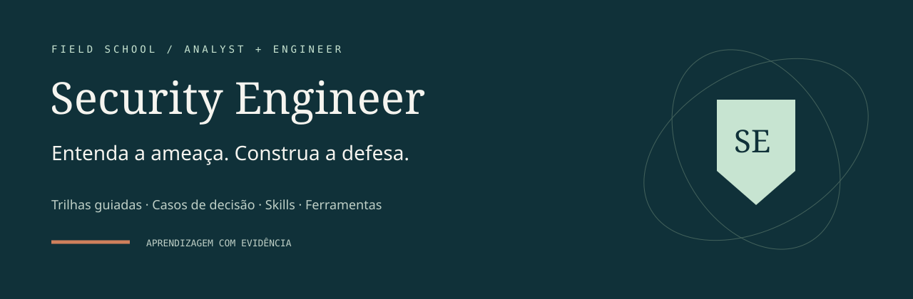
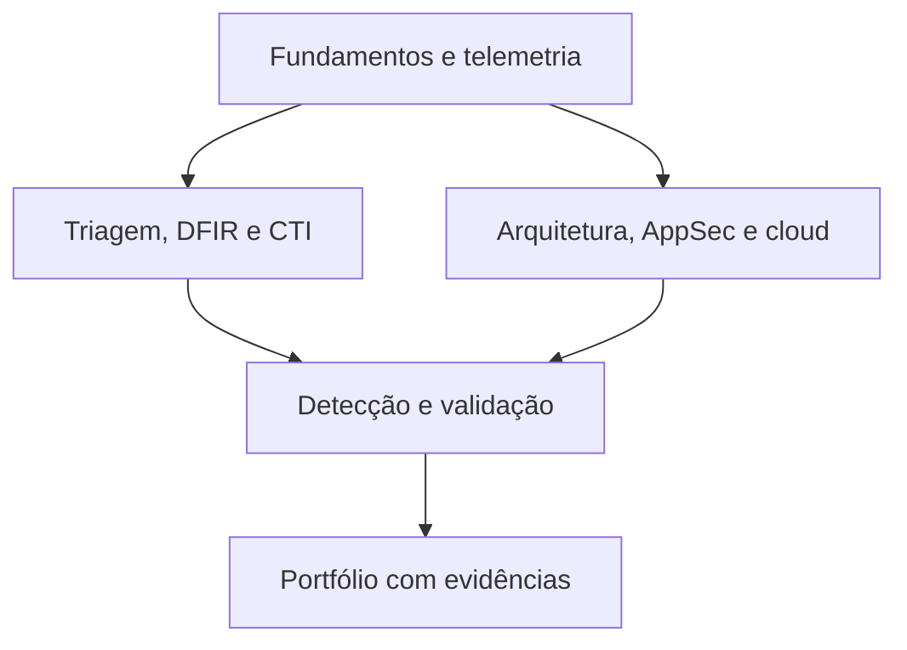

<p align="center"></p>

# Security Engineer

**Uma escola aberta de análise e engenharia de segurança, orientada a evidências e entregas verificáveis.**

   

[Comece pelo currículo](docs/CURRICULO.md) · [Guia de uso](docs/GUIA-DE-USO.md) · [Catálogo comentado](docs/CATALOGO.md) · [Skills de IA](docs/SKILLS-IA.md)

## O que você encontra

- **12 módulos guiados:** objetivos, fundamentos, passos, artefatos e critérios de aceite.
- **Duas rotas profissionais:** Security Analyst e Security Engineer, com base comum.
- **8 laboratórios de decisão:** evidências sintéticas, alternativas e feedback comentado.
- **24 recursos selecionados:** repositórios, ferramentas, guias e coleções de skills de IA.
- **Portal estático:** busca, filtros, pré-requisitos, progresso local, anotações e exportação JSON.

**Status:** primeira versão funcional de autoestudo. Os exercícios são decisões por regras, não ambientes de ataque ou emuladores. Os módulos são roteiros de estudo, não videoaulas. Conclusão de módulo é autodeclarada; texto livre e portfólio exigem revisão humana. Não há certificação.

## Escolha sua rota

| Rota | Sequência sugerida | Entrega final |
|---|---|---|
| Analyst | Fundamentos → Telemetria → Triagem → DFIR → CTI → Detecção → Purple team → IA | Investigação com timeline, consulta, evidências e resposta proposta |
| Engineer | Fundamentos → Telemetria → Arquitetura → AppSec → Cloud → Supply chain → Detecção → Purple team → IA | Modelo de ameaças, controle, teste de regressão e rollback |



## Começar localmente

Requer Python 3 para servir e Node.js 22+ para testes/build. Sem dependências npm ou CDN.

```bash
git clone https://github.com/Ridd1kulusC0d3r/securityengineer.git
cd securityengineer
npm test
npm run build
npm start
```

Abra **http://127.0.0.1:8000**. Use HTTP: módulos JavaScript não devem ser abertos por `file://`.

## Laboratórios

| Caso | Competência |
|---|---|
| Aprovação de MFA fora do padrão | Triagem e contenção de sessão |
| O silêncio do coletor | Saúde da telemetria e janela cega |
| Um IP não é um adversário | CTI, temporalidade e atribuição |
| Regra correta, campo errado | Mapeamento de campos e teste de detecção |
| O objeto de outra pessoa | Autorização por objeto |
| Menor privilégio sem indisponibilidade | IAM e continuidade |
| PR na fronteira de confiança | CI/CD e execução privilegiada |
| Backup não é recuperação | Recuperação verificável |

Os [roteiros e gabaritos](docs/labs/) também podem ser lidos no GitHub.

## Método e qualidade

Leia → explique → pratique → produza → revise. Uma ferramenta entra no catálogo junto de uma atividade concreta. Uma conclusão deve apontar para uma evidência. As estimativas de horas são editoriais, não carga horária certificada.

Os testes automatizados verificam integridade curricular, pré-requisitos sem ciclos, decisões dos casos, restauração do progresso, filtros e links locais. Não equivalem a auditoria de ferramentas externas ou validação visual em navegador.

## Privacidade

O portal não tem conta, backend ou analytics. Marcações, respostas e anotações ficam em `localStorage`, por navegador/origem. Exportação é local; não há importação ou sincronização nesta versão. Limpar o navegador apaga os dados locais.

## Documentação

- [Currículo e rubrica de portfólio](docs/CURRICULO.md)
- [Guia de uso passo a passo](docs/GUIA-DE-USO.md)
- [Catálogo de recursos](docs/CATALOGO.md)
- [Skills de IA e critérios de avaliação](docs/SKILLS-IA.md)
- [Arquitetura e identidade visual](docs/ARCHITECTURE.md)
- [Fontes, licenças e proveniência](docs/SOURCES.md)
- [Roadmap](docs/ROADMAP.md)
- [Como contribuir](CONTRIBUTING.md)

## Publicação no GitHub Pages

O workflow manual `Publish GitHub Pages` gera e publica `dist/`. No GitHub, selecione **Settings → Pages → Source → GitHub Actions**, depois execute o workflow na aba Actions. A URL esperada é `https://ridd1kulusc0d3r.github.io/securityengineer/`; a presença desses arquivos não confirma ativação ou publicação do Pages.

## Origem e licença

Inspirado no método de casos, evidências e decisões do [NetworkEngineer](https://github.com/Ridd1kulusC0d3r/networkengineer). Implementação e identidade próprias: petróleo, cobre e papel claro. Nenhum código de ferramentas externas foi incorporado; o catálogo contém links e descrições autorais. Sem afiliação ou endosso das organizações citadas. Consulte [LICENSE](LICENSE) e as licenças originais antes de reutilizar conteúdo externo.
